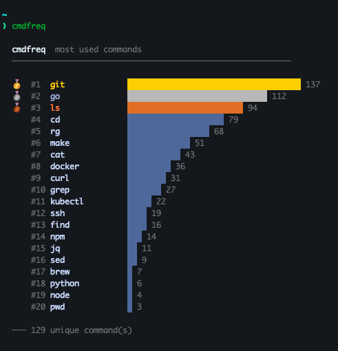

# cmdfreq

A CLI tool that analyzes your shell history and shows a ranked summary of your most-used commands.

## Installation

### Install script

Run one command:

```sh
curl -fsSL https://raw.githubusercontent.com/codestutis/cmdfreq/main/install.sh | sh
```

The installer supports Bash and Zsh on macOS, Linux, and WSL. It:

- installs `cmdfreq` to `$HOME/.local/bin`;
- adds that directory to `PATH`;
- configures persistent, shared shell history; and
- sets a default history file when `HISTFILE` is not already configured.

Open a new terminal after installation.

Shell settings are stored in `${XDG_CONFIG_HOME:-$HOME/.config}/cmdfreq/bashrc` or `zshrc`. The installer adds one marked source block to the relevant startup files. Before changing an existing startup file, it saves the original as `<file>.cmdfreq.bak`; an existing backup is never overwritten. Re-running the installer is safe and does not duplicate configuration.

To install a specific version:

```sh
curl -fsSL https://raw.githubusercontent.com/codestutis/cmdfreq/main/install.sh | VERSION=v0.4.0 sh
```

To use a custom installation directory:

```sh
curl -fsSL https://raw.githubusercontent.com/codestutis/cmdfreq/main/install.sh | BIN_DIR="$HOME/bin" sh
```

The custom directory is added to `PATH` by the generated shell configuration.

Native Windows is not supported; use WSL with Bash or Zsh history.

### Go install (deprecated)

`go install` is deprecated; use the installation script above. Existing Go-installed
binaries that include the updater can replace themselves with a release binary.

## Usage

```sh
cmdfreq [-n count] [--resolve-aliases] [<command>]
```

- Displays your top 20 most-used commands by default, ranked by frequency.
- Use `-n` to choose how many results to show.
- Use `--resolve-aliases` to count aliases as the commands they expand to.
- `cmdfreq git` shows the most-used arguments to `git`.
- `cmdfreq -n 10 git` shows the top 10 most-used arguments to `git`.

## Updating and version

```sh
cmdfreq --update          # latest stable GitHub release
cmdfreq -u               # same as --update
cmdfreq --update v0.4.0  # specific published release
cmdfreq -u 0.4.0         # leading v is optional
cmdfreq --version        # current running binary version
cmdfreq -v              # same as --version
```

Updates verify the release archive's SHA-256 checksum and replace the running
executable in its existing directory. That directory must be writable. Updates
preserve shell configuration and do not require Go, curl, or sudo. Symlinks to
cmdfreq are preserved; their target binary is replaced.

A specified version may be a downgrade or prerelease. Older releases may lack
update/version flags; use the installation script to upgrade again after such a
downgrade. Update and version flags cannot be combined with each other or with
history options. Locally built binaries report `dev` unless built with
`-ldflags "-X main.version=<version>"`.

## Example output


